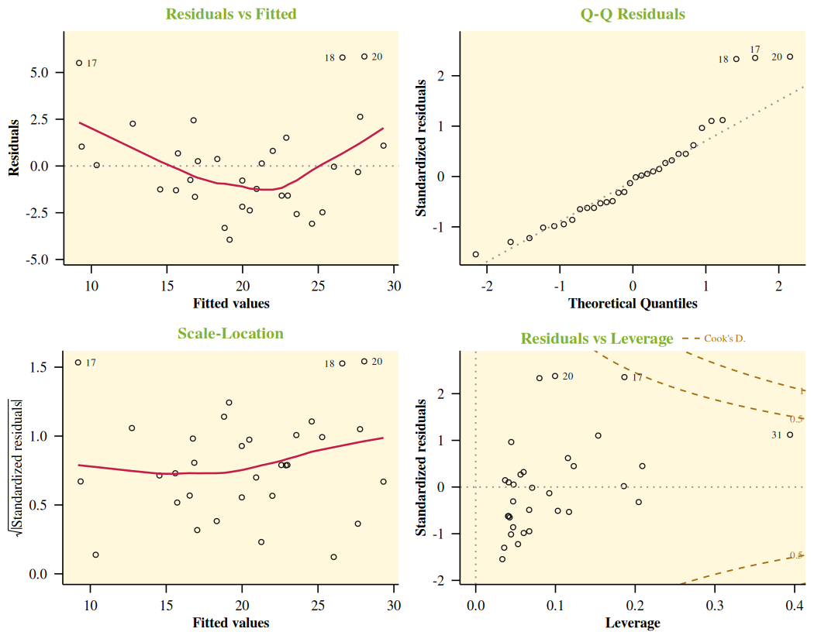

# snazzieR

Chic and sleek functions for beautiful statisticians.

snazzieR formats regression output for R Markdown reports. Its tables come out
as LaTeX for PDF documents or as plain text for the console, and its plots
share one ggplot2 theme and a palette of 35 named colors.

## Installation

```r
# Released version, from CRAN
install.packages("snazzieR")

# Development version, from GitHub
# install.packages("remotes")
remotes::install_github("DetectiveFierce/snazzieR")
```

## Functions

| Task | Functions |
|---|---|
| Summarize a linear model | `model.summary.table()`, `ANOVA.summary.table()`, `model.equation()` |
| Check a fitted model | `diagnostics.plots()`, `marginal.model.plots()`, `unusual.points.table()`, `VIF.table()` |
| Partial least squares | `pls.regression()`, `SVD.pls()`, `NIPALS.pls()`, `pls.summary()` |
| Ridge regression | `ridge.regression()`, `ridge.summary()` |
| Eigenvalues of a correlation or covariance matrix | `eigen.summary()` |
| Plot styling | `snazzieR.theme()`, `color.ref()`, and colors such as `Red` and `Dark.Blue` |

## Example

```r
library(snazzieR)

model <- lm(mpg ~ wt + hp, data = mtcars)

# Coefficients, fit statistics and the fitted equation in one table.
# Returns LaTeX by default; latex = FALSE prints to the console.
model.summary.table(model, title = "Fuel Economy", latex = FALSE)

# The four plot(lm) panels as ggplots
diagnostics.plots(model)

# Observations worth a second look, labelled by car name
unusual.points.table(model, latex = FALSE, id = rownames(mtcars))

# Variance inflation factors
VIF.table(model, latex = FALSE)
```



## Table previews

A LaTeX table has nothing to show when you run a chunk with the "Run" button,
so snazzieR tables print an HTML preview in RStudio and Positron and a
plain-text preview in other interactive sessions. Knitting produces the LaTeX.
Set `options(snazzieR.preview = "html")`, `"text"` or `"latex"` to pick one;
`?snazzieR_table` has the details.

## Documentation

* Guide with rendered examples: <https://finitesample.space/snazzier>
* Function reference and articles: <https://detectivefierce.github.io/snazzieR/>
* Changes in each release: [NEWS.md](NEWS.md)

Report bugs at <https://github.com/DetectiveFierce/snazzieR/issues>.

## License

MIT
