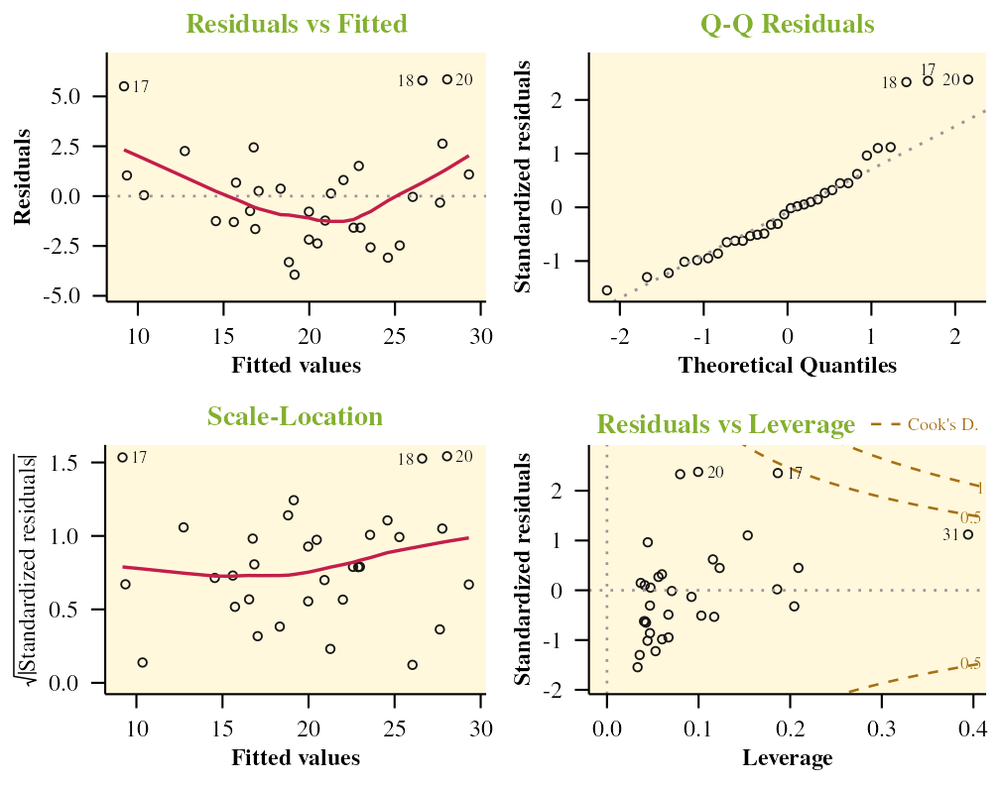
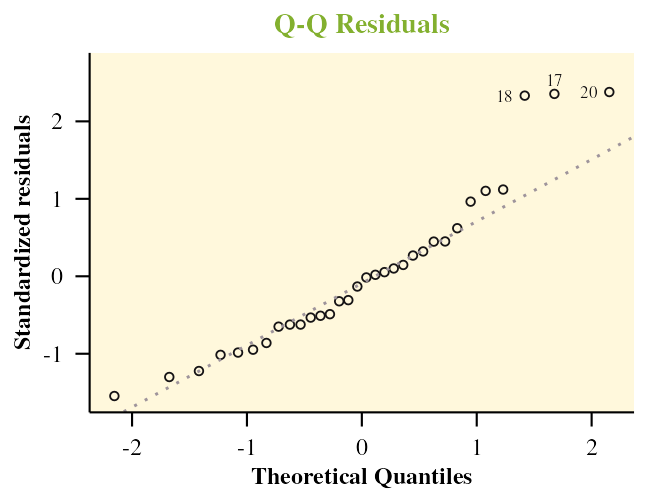
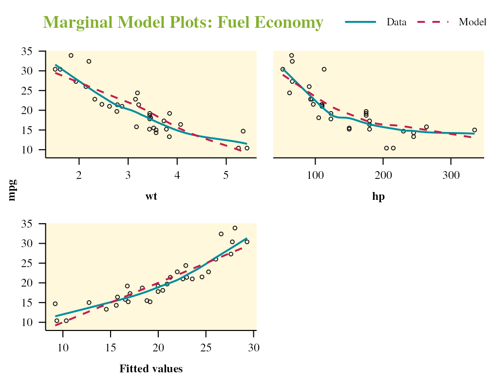

# Regression Diagnostics

snazzieR has four functions for checking a fitted regression: two plots
and two tables. This article runs all four on one model.

``` r

library(snazzieR)

model <- lm(mpg ~ wt + hp, data = mtcars)
```

The tables below use `latex = FALSE` because this page is HTML. In a PDF
report, leave `latex` at its default and the same calls return LaTeX
tables.

## Diagnostic plots

[`diagnostics.plots()`](https://detectivefierce.github.io/snazzieR/reference/diagnostics.plots.md)
draws the four panels of `plot(model)` as ggplots in
[`snazzieR.theme()`](https://detectivefierce.github.io/snazzieR/reference/snazzieR.theme.md).

``` r

diagnostics.plots(model)
```



Each panel labels its three most extreme observations with their row
numbers. `id.n` changes how many are labelled, and `cook.levels` sets
the Cook’s distance contours in the leverage panel.

The result is a list, so one panel can be drawn or modified by itself:

``` r

diagnostics.plots(model)$plots$qq
```



The four panels are named `residuals.fitted`, `qq`, `scale.location` and
`residuals.leverage`.

## Marginal model plots

[`marginal.model.plots()`](https://detectivefierce.github.io/snazzieR/reference/marginal.model.plots.md)
plots the response against each numeric term and against the fitted
values. Every panel carries two loess smooths: one of the data (solid)
and one of the model’s fitted values (dashed). Where the two curves
separate, the model misses part of the relationship with that variable.

``` r

marginal.model.plots(model, title = "Marginal Model Plots: Fuel Economy")
```



The smooths use the same loess settings as `car::mmps()`. Factors and
interaction terms are skipped, as they are in car.

## Unusual observations

[`unusual.points.table()`](https://detectivefierce.github.io/snazzieR/reference/unusual.points.table.md)
lists the observations that meet at least one of these criteria:

| Flag          | Criterion                                    |
|---------------|----------------------------------------------|
| High leverage | leverage above 2(p + 1)/n, twice the average |
| Outlier       | standardized residual beyond ±2              |
| Influential   | Cook’s distance above 4/(n − 2)              |
| Bad leverage  | high leverage and an outlier                 |

``` r

unusual.points.table(model, latex = FALSE, id = rownames(mtcars))
```

    ## == Unusual Observations ==
    ## 
    ## 
    ## Obs                   Observed   Fitted   Leverage   Std. Resid.   Cook's D   Flags                      
    ## --------------------  ---------  -------  ---------  ------------  ---------  ---------------------------
    ## Chrysler Imperial     14.7       9.192    0.1865     2.355         0.4236     outlier, influential       
    ## Maserati Bora         15         12.74    0.3942     1.12          0.272      high leverage, influential 
    ## Toyota Corolla        33.9       28.05    0.0995     2.379         0.2084     outlier, influential       
    ## Fiat 128              32.4       26.6     0.07991    2.332         0.1574     outlier, influential       
    ## Lincoln Continental   10.4       9.363    0.209      0.4497        0.01781    high leverage              
    ## Ford Pantera L        15.8       16.55    0.2044     -0.3227       0.00892    high leverage              
    ## 
    ## Flags: high leverage = h > 0.188 = 2(3)/32 = 2(p+1)/n;  outlier = |std. resid.| > 2;  influential = Cook's D > 0.133;  bad leverage = both.
    ## Outliers: 3 of 32 observations have |std. resid.| > 2; about 1.5 would be expected by chance.

`id` takes one label per row of the data, or the name of a column that
holds the labels. Without it, observations are identified by the row
names of the data.

Three arguments narrow the table. `flag` chooses which criteria count,
`n.max` keeps the rows with the largest Cook’s distances, and
`leverage.cutoff`, `residual.cutoff` and `cook.cutoff` replace the
default thresholds.

``` r

unusual.points.table(
  model,
  latex = FALSE,
  id = rownames(mtcars),
  flag = c("leverage", "outlier"),
  n.max = 3
)
```

    ## == Unusual Observations ==
    ## 
    ## 
    ## Obs                 Observed   Fitted   Leverage   Std. Resid.   Cook's D   Flags         
    ## ------------------  ---------  -------  ---------  ------------  ---------  --------------
    ## Chrysler Imperial   14.7       9.192    0.1865     2.355         0.4236     outlier       
    ## Maserati Bora       15         12.74    0.3942     1.12          0.272      high leverage 
    ## Toyota Corolla      33.9       28.05    0.0995     2.379         0.2084     outlier       
    ## 
    ## Flags: high leverage = h > 0.188 = 2(3)/32 = 2(p+1)/n;  outlier = |std. resid.| > 2;  bad leverage = both.
    ## Outliers: 3 of 32 observations have |std. resid.| > 2; about 1.5 would be expected by chance.
    ## Showing the 3 with the largest Cook's D of 6 flagged observations.

## Collinearity

[`VIF.table()`](https://detectivefierce.github.io/snazzieR/reference/VIF.table.md)
reports a variance inflation factor for each term, sorted from highest
to lowest. A term is flagged moderate above 5 and severe above 10;
`moderate` and `severe` change those cutoffs.

``` r

bigger <- lm(mpg ~ wt + hp + disp + qsec, data = mtcars)
VIF.table(bigger, latex = FALSE)
```

    ## == Variance Inflation Factors ==
    ## 
    ## 
    ## Term   VIF     1/VIF    GVIF    adj. GVIF        Flag     
    ## -----  ------  -------  ------  ---------------  ---------
    ## disp   7.985   0.1252   7.985   2.826 (df = 1)   moderate 
    ## wt     6.917   0.1446   6.917   2.63 (df = 1)    moderate 
    ## hp     5.167   0.1935   5.167   2.273 (df = 1)   moderate 
    ## qsec   3.133   0.3192   3.133   1.77 (df = 1)             
    ## 
    ## Moderate: VIF > 5.  Severe: VIF > 10.  Mean VIF = 5.8.
    ## adj. GVIF = GVIF^(1/(2 Df)).

A factor has several coefficients and therefore no ordinary VIF. For
such terms the table reports the generalized VIF of Fox and Monette
(1992), and the VIF column shows the adjusted GVIF squared so that it
stays on the same scale as the other rows. The values match
`car::vif()`.

``` r

VIF.table(lm(mpg ~ wt + hp + factor(cyl), data = mtcars), latex = FALSE)
```

    ## == Variance Inflation Factors ==
    ## 
    ## 
    ## Term          VIF     1/VIF    GVIF    adj. GVIF        Flag 
    ## ------------  ------  -------  ------  ---------------  -----
    ## hp            3.496   0.286    3.496   1.87 (df = 1)         
    ## wt            2.581   0.3875   2.581   1.607 (df = 1)        
    ## factor(cyl)   2.26    0.4426   5.106   1.503 (df = 2)        
    ## 
    ## Moderate: VIF > 5.  Severe: VIF > 10.  Mean VIF = 2.78.
    ## adj. GVIF = GVIF^(1/(2 Df)).  For multi-df terms, VIF = (adj. GVIF)^2.

`cols` limits the table to the columns you want:

``` r

VIF.table(bigger, latex = FALSE, cols = c("VIF", "1/VIF"))
```

    ## == Variance Inflation Factors ==
    ## 
    ## 
    ## Term   VIF     1/VIF    Flag     
    ## -----  ------  -------  ---------
    ## disp   7.985   0.1252   moderate 
    ## wt     6.917   0.1446   moderate 
    ## hp     5.167   0.1935   moderate 
    ## qsec   3.133   0.3192            
    ## 
    ## Moderate: VIF > 5.  Severe: VIF > 10.  Mean VIF = 5.8.

## Running chunks interactively

With `latex = TRUE`, both tables return LaTeX. If you run such a chunk
with the “Run” button in RStudio or Positron, snazzieR shows an HTML
preview of the table; knitting the document produces the LaTeX.
[`?snazzieR_table`](https://detectivefierce.github.io/snazzieR/reference/snazzieR_table.md)
describes the `snazzieR.preview` option that controls this.

## Reference

Fox, J. and Monette, G. (1992). Generalized collinearity diagnostics.
*Journal of the American Statistical Association*, 87, 178–183.
